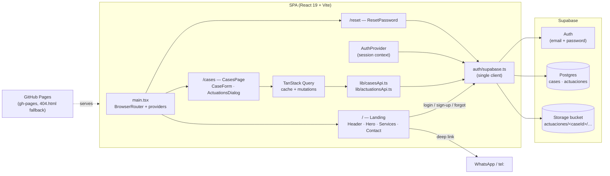

# Tu Abogado

A law-firm website with a built-in **case management module for lawyers**: a public landing page (services, WhatsApp/phone contact) plus an authenticated area where lawyers register their court cases and log each case's procedural actions (*actuaciones*) with file attachments. It is a serverless SPA: React talks directly to Supabase (Auth, Postgres, Storage).


## Architecture



### Layers

- **Bootstrap & routing**: `src/main.tsx` composes the provider stack (MUI `ThemeProvider` → `AuthProvider` → `QueryClientProvider` → `BrowserRouter`) and declares three routes: `/` (landing), `/cases` (case management) and `/reset` (password reset). The router `basename` comes from `import.meta.env.BASE_URL`, so the same build works at `/` locally and under a sub-path on GitHub Pages.
- **UI (Atomic Design)**: `src/components/` is split into `atoms/` (`Button`, `Input`, `Heading`, `SectionTitle`), `molecules/` (`ServiceCard`, `LawServices`, `ContactForm`, `ValueIcon`), `organisms/` (`Header`, `Hero`, `Services`, `Contact`, and the `cases/` feature: `CaseForm`, `ActuationsDialog`) and `pages/` (`CasesPage`, `ResetPassword`). Each component lives in its own folder with an `index.ts` barrel.
- **Authentication**: `src/auth/supabase.ts` creates a single Supabase client with persisted, auto-refreshing sessions. `src/auth/AuthProvider.tsx` exposes `{ user, loading }` through React Context, seeded with `getSession()` and kept in sync with `onAuthStateChange`. Login, sign-up (with e-mail confirmation) and forgot-password dialogs live in `organisms/Header`; `/reset` completes the recovery flow with `auth.updateUser`.
- **Server state**: `CasesPage` and `ActuationsDialog` use TanStack Query: `useQuery` keyed by `['cases']` and `['acts', caseId]`, `useMutation` for create/update/delete with cache invalidation on success.
- **Data access**: `src/lib/casesApi.ts` and `src/lib/actuationsApi.ts` are thin typed repositories over the Supabase query builder (`LegalCase`, `Actuacion` types). `casesApi` normalises rows coming from the DB and strips legacy columns before writes; `actuationsApi` also uploads attachments to Storage under `<caseId>/<timestamp>-<filename>` and stores only the object path.
- **Forms & validation**: `react-hook-form` + `zod` (`@hookform/resolvers`) for the login/register forms and the case form (case type, court type/name, docket number, claimant ID, defendants as a comma-separated list).
- **Design system**: `src/design/theme.ts` (MUI theme: palette, typography, component overrides), `src/design/tokens.ts` (colors, radii, shadows, spacing scale) and `globals.css`.
- **Contact channel**: the landing's `Contact` and `Hero` organisms build `wa.me` deep links with a prefilled message and `tel:` links; there is no backend for the contact form.

## Key design decisions

- **Backend-as-a-Service instead of a custom API**: the app has no server code; auth, relational data and file storage are all Supabase, accessed with the public anon key. Data authorization therefore relies on Supabase Row Level Security policies (configured in the Supabase project, not in this repo).
- **Repository modules between UI and Supabase**: components never call `supabase.from(...)` directly for cases or actions; they go through `lib/*Api.ts`, which keeps typing, payload cleaning and storage paths in one place.
- **Server state in TanStack Query, auth state in Context**: no global store; query keys plus invalidation keep the table and dialogs consistent after mutations.
- **Atomic Design with path aliases**: `vite.config.ts` defines `@atoms`, `@molecules`, `@organisms`, `@pages`, `@lib`, `@auth`, `@design`, `@cases`, etc., so imports reflect the component hierarchy.
- **Static hosting with SPA fallback**: `postbuild` copies `index.html` to `404.html` (GitHub Pages) and `public/_redirects` provides the equivalent rewrite for Netlify-style hosts; `VITE_BASE` sets the sub-path at build time.
- **Attachments stored by path, resolved to URLs at render time** (`getPublicUrl`), so the bucket can later be switched to signed URLs without migrating data.

## Tech stack

| Area | Library | Version |
|---|---|---|
| UI | React / React DOM | ^19.1.1 |
| Language | TypeScript | ~5.9.3 |
| Build | Vite + @vitejs/plugin-react | ^7.1.7 / ^5.0.4 |
| Components | MUI (`@mui/material`, `@mui/icons-material`) + Emotion | ^7.3.4 / ^11.14 |
| Routing | react-router-dom | ^7.9.5 |
| Server state | @tanstack/react-query | ^5.90.7 |
| Forms / validation | react-hook-form + zod + @hookform/resolvers | ^7.66.0 / ^4.1.12 / ^5.2.2 |
| Backend (BaaS) | @supabase/supabase-js (Auth, Postgres, Storage) | ^2.81.0 |
| Lint | ESLint + typescript-eslint + react-hooks / react-refresh plugins | ^9.36.0 |
| Hosting | gh-pages | ^6.3.0 |

## Project structure

```
tu-abogado/
├── index.html
├── vite.config.ts          # base path from VITE_BASE + path aliases
├── public/                 # logos, _redirects (SPA rewrite)
└── src/
    ├── main.tsx            # providers + routes (/, /cases, /reset)
    ├── App.tsx             # landing: Header · Hero · Services · Contact
    ├── auth/               # supabase.ts (client), AuthProvider.tsx (context)
    ├── lib/                # casesApi.ts, actuationsApi.ts (data access + storage)
    ├── design/             # theme.ts, tokens.ts, globals.css
    └── components/
        ├── atoms/          # Button, Input, Heading, SectionTitle
        ├── molecules/      # ServiceCard, LawServices, ContactForm, ValueIcon
        ├── organisms/      # Header, Hero, Services, Contact
        │   └── cases/      # CaseForm, ActuationsDialog
        └── pages/          # CasesPage, ResetPassword
```

## Getting started

Requirements: Node.js 20+ and a Supabase project with the `cases` and `actuaciones` tables, an `actuaciones` Storage bucket and RLS policies for authenticated users (the database schema is not included in this repo).

Create a `.env.local` file (git-ignored) with your own values:

```bash
VITE_BASE=/                      # sub-path when hosted under one, e.g. /tu-abogado/
VITE_SUPABASE_URL=<your-supabase-project-url>
VITE_SUPABASE_ANON_KEY=<your-supabase-anon-key>
```

```bash
npm install
npm run dev        # Vite dev server
npm run build      # tsc -b && vite build (+ copies index.html to 404.html)
npm run preview    # serve the production build locally
npm run lint       # ESLint
npm run deploy     # build and publish dist/ to the gh-pages branch
```

## My role

Designed and implemented the application end to end: React + TypeScript front end with an Atomic Design component library, Supabase authentication and data/storage layer, case-management UI with TanStack Query, and static hosting on GitHub Pages.

---

### Resumen en español

Sitio para un estudio de abogados con un módulo de gestión de casos: landing pública (servicios y contacto por WhatsApp) y un área autenticada donde cada abogado registra sus causas y las actuaciones de cada una, con archivos adjuntos. Es una SPA en React 19 + TypeScript + Vite con MUI, sin backend propio: usa Supabase para autenticación, base de datos Postgres y almacenamiento de archivos. Los componentes siguen Atomic Design, el acceso a datos está aislado en `lib/*Api.ts` y el estado del servidor se maneja con TanStack Query. Se publica como sitio estático en GitHub Pages.
